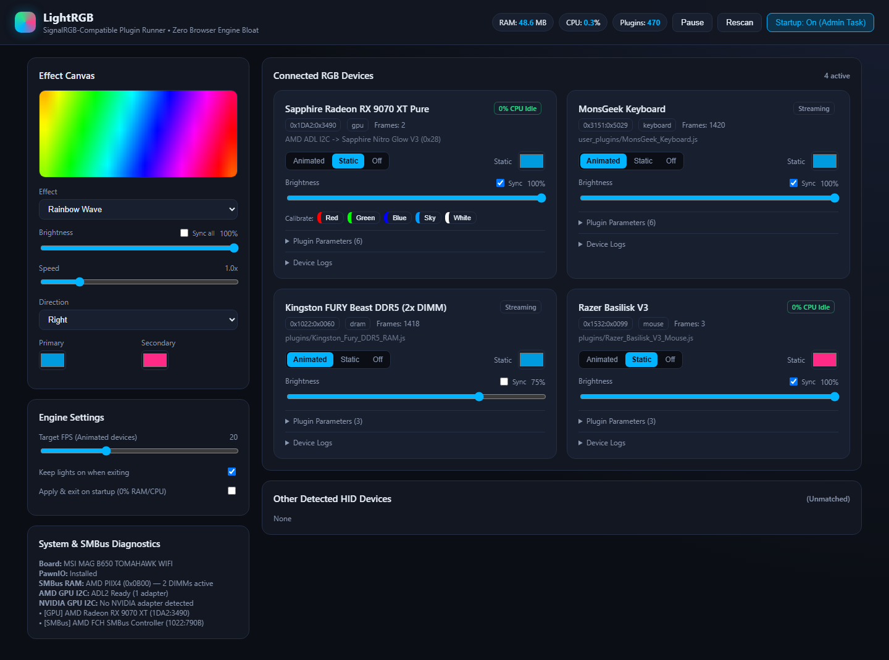
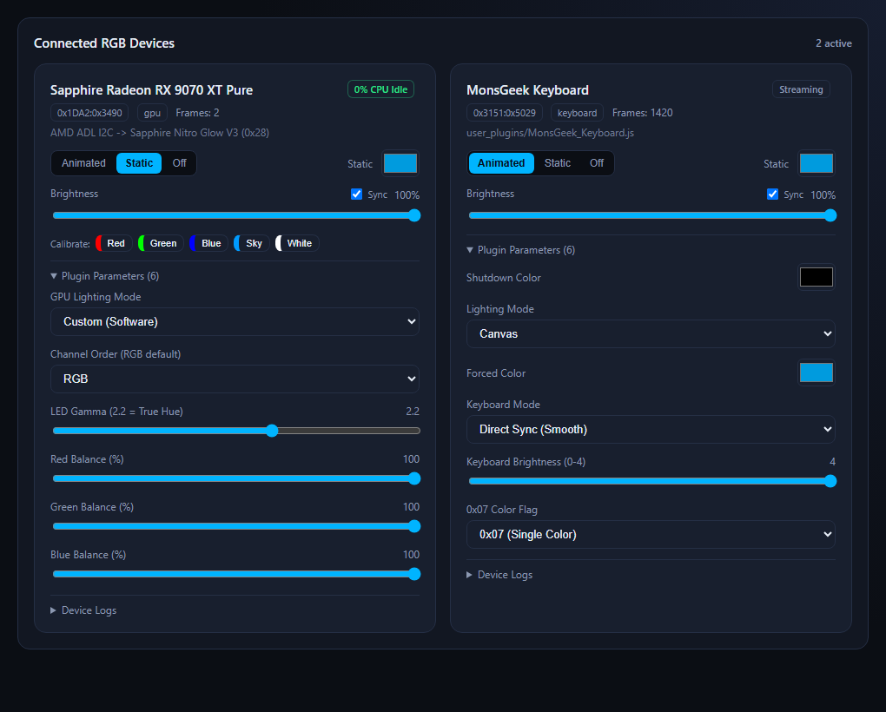

# LightRGB

Lightweight native Windows RGB controller compatible with the **SignalRGB JavaScript plugin format** (`.NET 10` + `Microsoft.ClearScript.V8`), **PawnIO SMBus**, **AMD ADL I2C**, **NVIDIA NVAPI I2C**, and universal **USB HID LampArray** (`UsagePage 0x59`) — with **zero Chromium / Ultralight bloat**.



## Quick Start (Portable Release)
1. Extract `LightRGB-Portable-win-x64.zip` to a permanent folder (for example `C:\Tools\LightRGB`). *(No `.NET 10` installation required.)*
2. Double-click **`LightRGB.exe`**.
   - **Administrator UAC prompt:** LightRGB embeds `requireAdministrator` so Windows automatically asks for Administrator elevation (required for SMBus RAM and hardware access). Click **Yes**.
   - If Windows SmartScreen warns about an unrecognized app, click **More info → Run anyway**.
   - **First-run PawnIO prompt (for RGB RAM):** If the signed **PawnIO** kernel driver isn't installed yet, LightRGB offers to install the bundled `pawnio\PawnIO_setup.exe` silently (`-install -silent`) right before launching.
   - **First-run SignalRGB plugins prompt:** LightRGB checks next to `LightRGB.exe` and in `Downloads` for `Install_SignalRgb.exe`, or lets you pick it via a file dialog (or later via **Tray Icon → Import SignalRGB Plugins...**).
3. Your browser opens **`http://127.0.0.1:4747/`** automatically. Adjust effects, colors, or per-device brightness, then close the browser tab — all changes auto-save within 400 ms.

## Supported Hardware
* **USB HID Peripherals & Motherboards:** Locally extracts and runs ~469 SignalRGB JS plugins + universal **USB HID LampArray** (`0x59`).
* **MonsGeek / RongYuan Keyboards (`0x3151:0x5029` / `0x5026` / `0x502F` / `0x502D`):** Built-in community plugin with smooth volatile `0x0E` streaming (`Direct Sync`) and onboard `0x07` presets.
* **RGB RAM (SMBus via bundled PawnIO):** Supports both **AMD (`SmbusPIIX4.bin`)** and **Intel (`SmbusI801.bin`)** platforms, with hardware safety guards blocking SPD EEPROM writes (`0x50–0x57`).
* **GPUs (AMD & NVIDIA):**
  - **Sapphire Radeon GPUs:** Native AMD ADL Nitro Glow V3 controller (RX 5000–9000) with selectable channel order, sRGB-to-LED gamma (`2.2`), and per-channel white balance.
  - **ASRock AMD & NVIDIA GPUs (ASUS, MSI, Gigabyte, EVGA, PNY, Colorful, Lenovo):** Runs SignalRGB's ~20 SMBus/I2C GPU plugins over `nvapi64.dll` and AMD ADL (`atiadlxx.dll`). *(Direct Wi-Fi lights and serial devices are not yet supported.)*

## Day-to-Day Usage & Startup
* **Run at Startup (Zero UAC Prompt):** Click **Startup** in `http://127.0.0.1:4747/` so it reads **`Startup: On (Admin Task)`**. Windows will launch LightRGB silently at logon with highest privileges.
* **Tray Mode (default):** Keeps a tiny tray icon near the clock (~0% CPU when devices are set to `Static`). Double-click the tray icon (or `LightRGB.exe`) to open the Control Panel; right-click → **Exit** to close completely.
* **Apply & Exit Mode (`0% RAM / 0% CPU`):** Check **Apply & exit on startup (0% RAM/CPU)** and **Keep lights on when exiting** in Engine Settings. At Windows logon, LightRGB silently applies your static colors across all devices and exits automatically.
* **Per-Device Brightness & Sync:** Every device card lets you choose **Animated / Static / Off**, individual **Brightness (`0–100%`)**, and **Sync** (or **Sync all** globally).

### Per-Device Controls & GPU Calibration


## Portable Mode & CLI Options
Place an empty `portable.txt` file next to `LightRGB.exe` to store `data\` (config & extracted plugins) inside the app folder instead of `%LOCALAPPDATA%\LightRGB`.

| Flag | Description |
| :--- | :--- |
| `--extract [path]` | Extract plugins & components from `Install_SignalRgb.exe` and rebuild `plugin-index.json` |
| `--scan` | Print motherboard/BIOS, AMD ADL / NVIDIA NVAPI GPU I2C, PawnIO/SMBus RAM, and USB HID scan results |
| `--minimized`, `--silent` | Start silently in the Windows System Tray without opening the browser |
| `--no-tray` | Run headless in console (press `Ctrl+C` to exit) |
| `--apply-and-exit [ms]` | Apply configured colors/effects for `ms` (default `2500`) keeping lights on, then exit |
| `--port <port>` | Override localhost Web UI port (default `4747`) |
| `--data-dir <path>` | Override data/config/plugins directory |

## Building From Source
Requires the **.NET 10 SDK** on Windows x64:

```powershell
# Build & run mocked test suite (optional: set SIGNALRGB_INSTALLER=<path> to include SignalRGB plugin extraction tests)
dotnet build LightRGB.sln -c Release -p:Platform=x64
dotnet test LightRGB.sln -c Release -p:Platform=x64 --no-build

# Build clean self-contained portable folder & ZIP (fetches official signed PawnIO_setup.exe automatically)
.\scripts\build-portable.ps1
```

## Credits & Acknowledgments
* **[SignalRGB](https://signalrgb.com) (WhirlwindFX):** Huge credit to the SignalRGB team and community for designing the JavaScript device plugin specification and building a massive hardware plugin ecosystem. If you want advanced effects, game integrations, cooling control, and official support, check out SignalRGB directly.
* **[PawnIO](https://pawnio.eu) (`namazso`):** For the signed PawnIO driver and SMBus modules (`SmbusPIIX4.bin`, `SmbusI801.bin`) that make safe RGB RAM control possible on modern Windows.
* **Open-Source RGB Community:** For hardware protocol documentation (AMD ADL Nitro Glow V3, MonsGeek HID, and community-authored plugins).

## Disclaimer & License
* **Hardware Risk Notice:** LightRGB writes directly to USB HID, SMBus, and GPU I2C interfaces. Although strict safety guards block known critical addresses (such as SPD EEPROMs `0x50–0x57` and Sapphire `0x3E`), this software is provided **AS-IS** with **no warranty** — use at your own risk.
* **Non-Affiliation:** LightRGB (`jaloliddin-rus/LightRGB`) is an independent open-source project and is **not** affiliated with, endorsed by, or sponsored by WhirlwindFX or SignalRGB.
* **License:** Licensed under the **GNU General Public License v3.0** ([LICENSE](LICENSE)). See [THIRD_PARTY_NOTICES.md](THIRD_PARTY_NOTICES.md) for PawnIO (GPLv2 with linking exception), ClearScript V8 (MIT), and xUnit (Apache 2.0) attributions.
